# 3D モデルビューア 取扱説明書

版 0.2.0 ／ この説明書の画面写真は、サンプルの「ブルドーザー」モデル（架空の機械・部品数 2,648）で撮っています。

## 1. このアプリでできること

タッチパネルやパソコンのブラウザで、CAD から作った 3D モデルを回したり拡大したりしながら確認できるアプリです。

- 指（またはマウス）で 3D モデルを回す・拡大する・動かす
- 部品をタップして名前を見る、じゃまな部品を隠して中を見る
- 部品に説明のラベル（注釈）を付ける
- よく使う見え方（視点）を名前を付けて保存し、ボタン1つで呼び出す
- 今の画面・注釈・メモを PDF にして、決めたフォルダ（ネットワーク上も可）に保存する
- STEP ファイル（CAD の受け渡し形式）を、このアプリで見られる形式（.glb）に変換する

> このアプリの表示や PDF は確認のための補助です。法令にもとづく記録や、安全にかかわる判断に、このアプリだけを用いないでください。

## 2. はじめに（準備と起動）

### 2.1 必要なもの

- Windows 10 / 11
- Node.js（LTS 版）… ビューアに必要
- Python 3.12（インストール時に「Add Python to PATH」にチェック）… 変換ツールを使う人だけ必要
- インターネット接続（初回セットアップのときだけ）

### 2.2 初回セットアップ（最初の1回だけ）

アプリのフォルダにある **「初回セットアップ.bat」** をダブルクリックします。10〜20 分ほどかかります。終わると黒い画面に「セットアップが終わりました。」と出ます。

### 2.3 ビューアを起動する

**「ビューア起動.bat」** をダブルクリックすると、ブラウザが自動で開きます。

- 黒い画面は閉じないでください。閉じるとビューアが止まります。
- 同じネットワークの他のパソコンやタッチパネルからは、黒い画面に出る「Network: http://…:4000/」のアドレスを開くと見られます。

### 2.4 見せたいモデルを置く

`viewer\models\` フォルダに `.glb` ファイルを置くと、最初の画面の一覧に出ます。ボタンを押すとモデルが開きます。

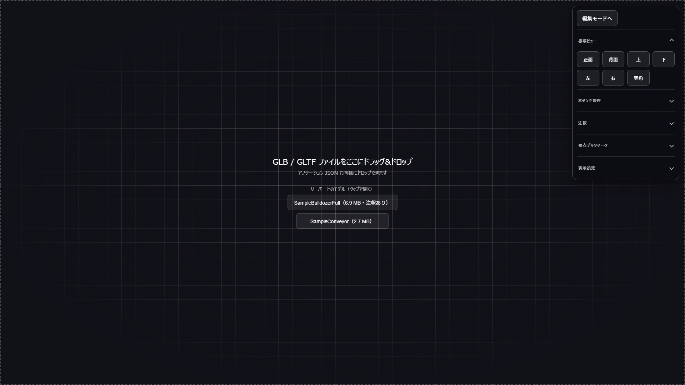
*最初の画面。サーバー上のモデルがボタンで並びます*

`.glb` ファイルをブラウザの画面にドラッグ&ドロップして開くこともできます。

## 3. 画面の見かた

モデルを開くと、次のような画面になります。

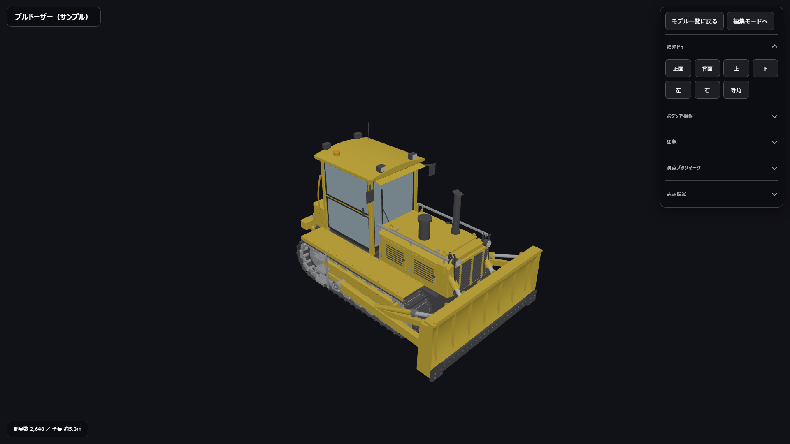
*左上がモデルの名前、左下が説明（スペック）、右上が操作パネルです*

右上の操作パネルは、項目ごとに開いたり閉じたりできます（見出しを押すと開閉します）。

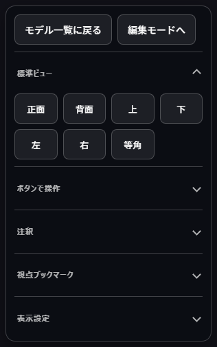
*操作パネル（閲覧モード）*

| 場所 | 内容 |
|---|---|
| モデル一覧に戻る | 最初の画面に戻ります |
| 編集モードへ | ラベルの追加や保存ができる「編集モード」に切り替えます |
| 標準ビュー | 決まった向きから見ます |
| ボタンで操作 | 指の操作が難しいときに、ボタンで回転・移動・拡大します |
| 注釈 | ラベルの一覧を出します |
| 視点ブックマーク | 見え方の保存・呼び出しと、PDF 保存 |
| 表示設定 | ラベル・エッジ・展示モード・明るさ・文字の大きさ |

## 4. モデルを動かす

### 4.1 指・マウスでの操作

| したいこと | タッチパネル | マウス |
|---|---|---|
| 回す | 1本指でなぞる | 左ボタンを押したまま動かす |
| 拡大・縮小 | 2本指でつまむ・広げる | ホイールを回す |
| 平行に動かす | 2本指でなぞる | 右ボタンを押したまま動かす |
| 回転の中心を決める | 見たい所をすばやく2回タップ | 見たい所をダブルクリック |
| 回転の中心を戻す | 何もない所を2回タップ | 何もない所をダブルクリック |

### 4.2 標準ビュー

「標準ビュー」の **正面・背面・上・下・左・右・等角** を押すと、その向きにカメラが動きます。「等角」は斜め上から見た、全体がわかりやすい向きです。

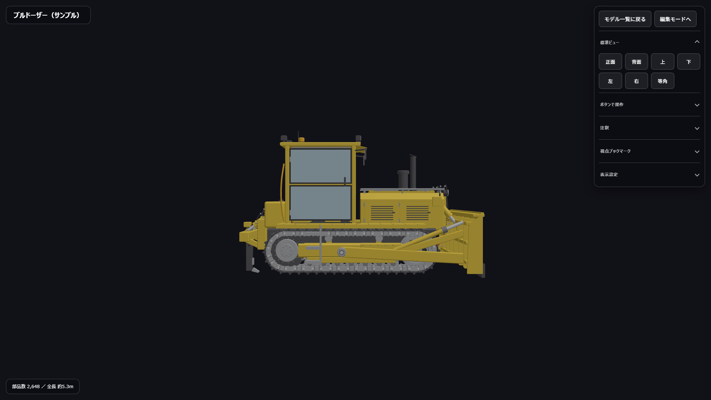
*「正面」を押したところ。どの面が「正面」になるかは、CAD データの向きで決まります（このサンプルでは横から見た姿になります）*

### 4.3 ボタンで操作

ピンチ操作が難しいときは、「ボタンで操作」を開くと、矢印ボタンで回転・平行移動、＋／－ボタンで拡大・縮小ができます。

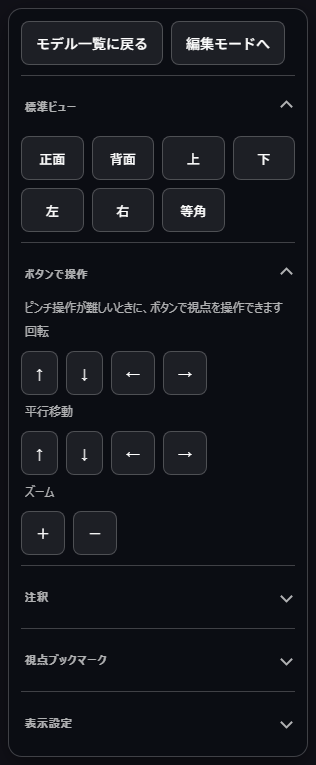
*「ボタンで操作」を開いたところ*

## 5. 部品を見る・隠す

### 5.1 部品の名前を見る

部品をタップすると、その部品が青く光り、右下に部品の名前が出ます。

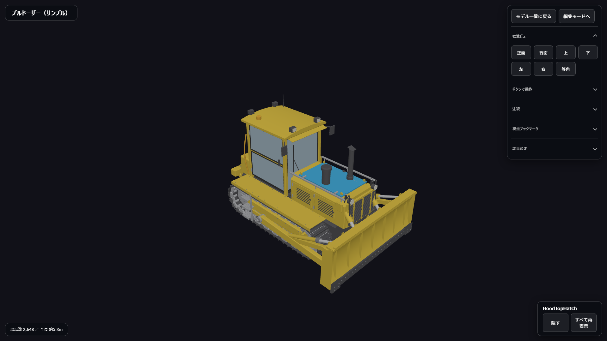
*フードの上ぶた（HoodTopHatch）をタップしたところ*

何もない所をタップすると、選択が外れます。

### 5.2 部品を隠して中を見る

部品を選んだ状態で右下の **「隠す」** を押すと、その部品が見えなくなります。外側の部品を順に隠すと、中の部品が見えます。

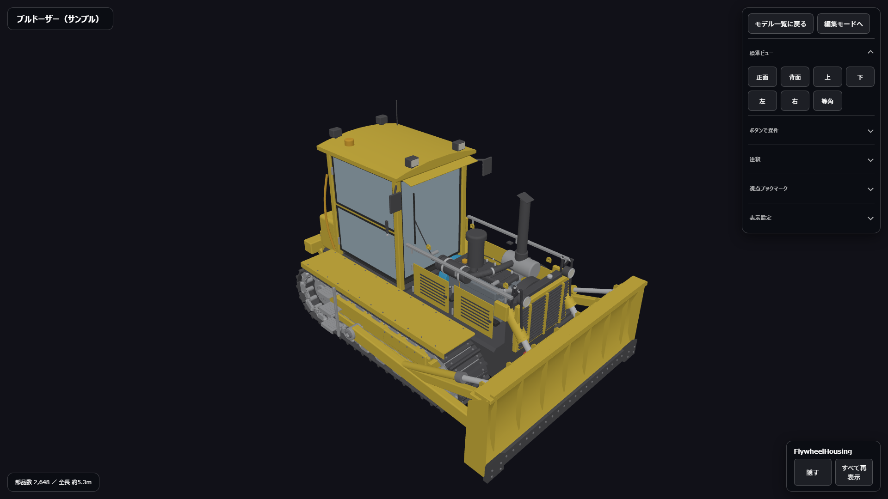
*フードの上ぶたとフード本体を隠したところ。中のエンジンまわりが見えます*

隠した部品を元に戻すときは、どれかの部品を選んで **「すべて再表示」** を押します。

## 6. 見え方を保存する（視点ブックマーク）

今のカメラの位置と、隠している部品の状態を、名前を付けて保存できます。説明のたびに同じ見え方をすぐ出せます。

1. 見せたい向きにモデルを動かし、必要なら部品を隠します
2. 「視点ブックマーク」を開き、**「ビュー保存」** を押します
3. 名前を入れて **「追加」** を押します

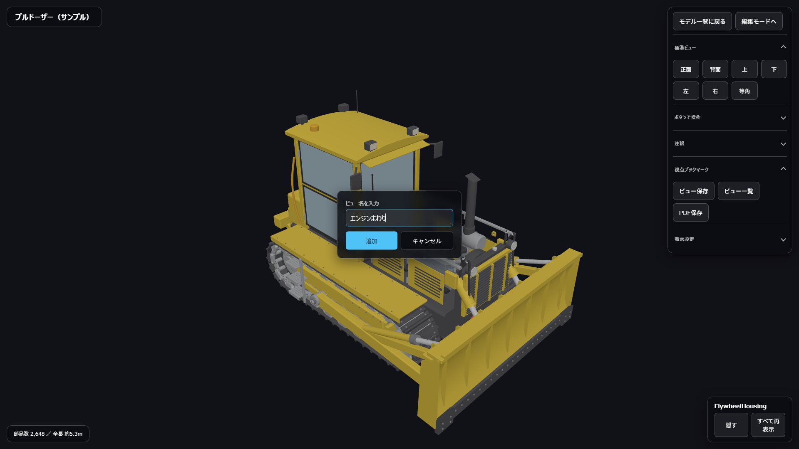
*フードを隠した状態を「エンジンまわり」として保存するところ*

**「ビュー一覧」** を押すと、保存した見え方が左下に並びます。名前を押すとその見え方に戻り、「削除」で消せます。

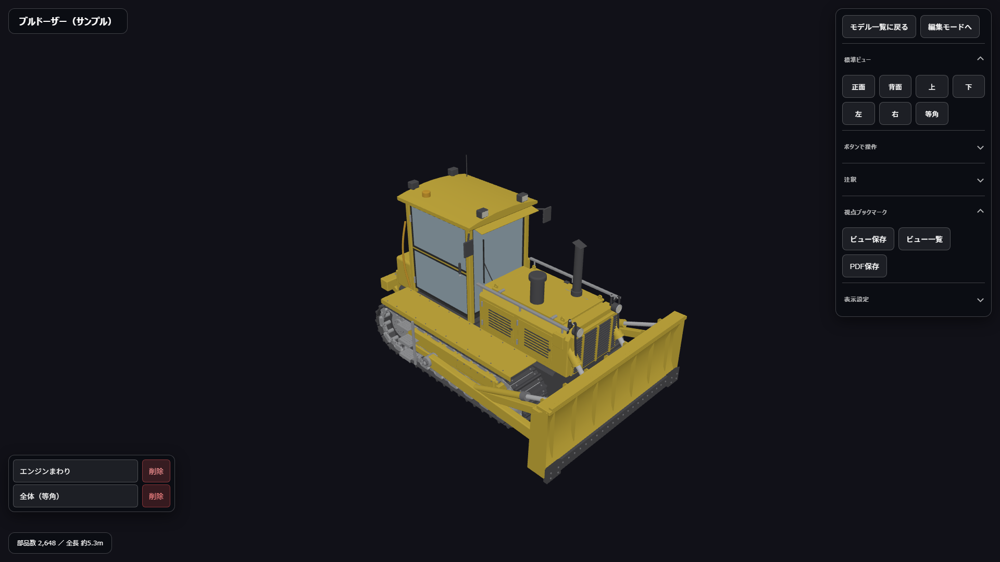
*保存した見え方の一覧（左下）*

> 保存した見え方を次回も使うには、編集モードの **「保存」** を押してください（7.3）。

## 7. ラベル（注釈）を付ける ― 編集モード

### 7.1 編集モードに切り替える

操作パネルの **「編集モードへ」** を押すと、**「保存」「ラベル追加」** のボタンが増えます。戻すときは **「閲覧モードへ」** を押します。

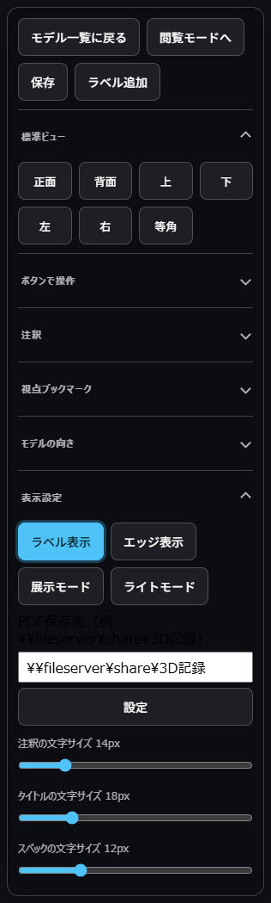
*編集モードの操作パネル。「表示設定」を開くと PDF の保存先も設定できます*

### 7.2 ラベルを追加する

1. **「ラベル追加」** を押します（画面の下に「3D モデル上をタップしてラベルを配置してください」と出ます）
2. ラベルを付けたい場所をタップします
3. 文字を入れて **「追加」** を押します

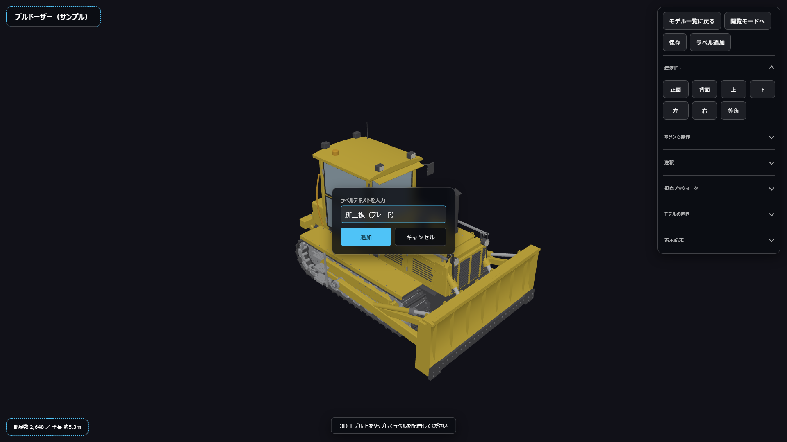
*排土板にラベルを付けるところ*

ラベルは部品に付いて動くので、モデルを回しても正しい場所を指します。部品を隠すと、その部品のラベルも隠れます。

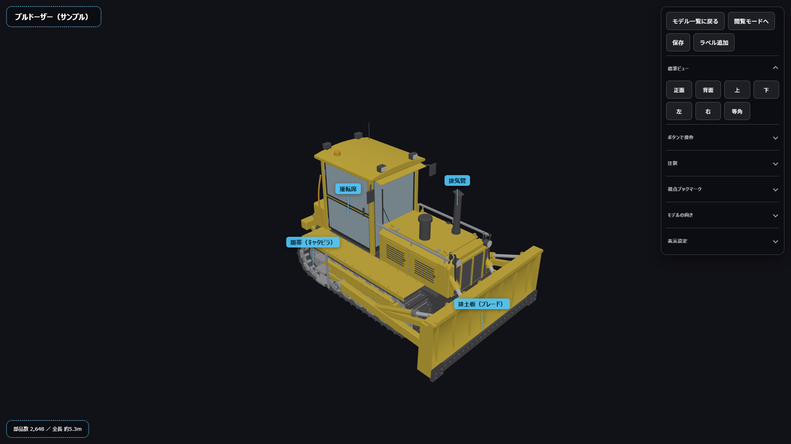
*ラベルを4つ付けたところ*

### 7.3 保存する

**「保存」** を押すと、ラベルと視点ブックマークがサーバーに保存されます（`viewer\models\` に「モデル名_annotations.json」ができます）。次にモデルを開いたとき、自動で読み込まれます。

### 7.4 ラベルの一覧

「注釈」を開いて **「注釈一覧」** を押すと、ラベルが左上に並びます。名前を押すとその場所にカメラが近づき、「削除」で消せます。

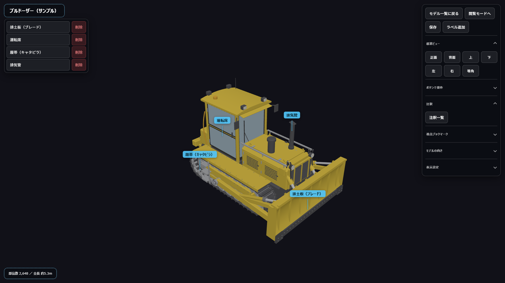
*ラベルの一覧（左上）*

## 8. PDF にして保存する

今の画面・ラベル・メモを、A4 横 1 枚の PDF にして、決めたフォルダに保存します。点検や打ち合わせの記録に使えます。

### 8.1 保存先のフォルダを決める（最初の1回）

1. **「編集モードへ」** を押し、「表示設定」を開きます
2. 「PDF保存先」に、保存したいフォルダの場所を入れます
   - パソコンの中のフォルダ：例 `D:\3D記録`
   - ネットワーク上のフォルダ：例 `\\fileserver\share\3D記録`
3. **「設定」** を押します。書き込めるフォルダなら「PDF保存先を設定しました」と出ます

### 8.2 PDF を保存する

1. 見せたい向きにモデルを動かし、必要ならラベルを付けたり部品を隠したりします
2. 「視点ブックマーク」を開き、**「PDF保存」** を押します
3. メモを入れて（空欄でも可）**「保存」** を押します

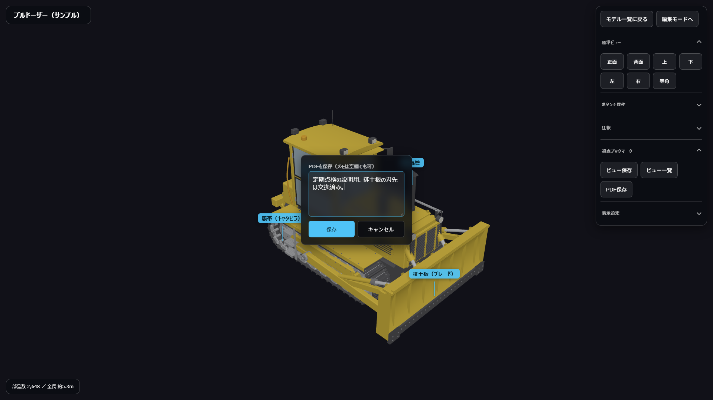
*メモは500文字まで入れられます*

保存先のフォルダに「モデル名_日付-時刻.pdf」ができます。同じ名前のファイルがあっても上書きせず、別の名前で保存します。

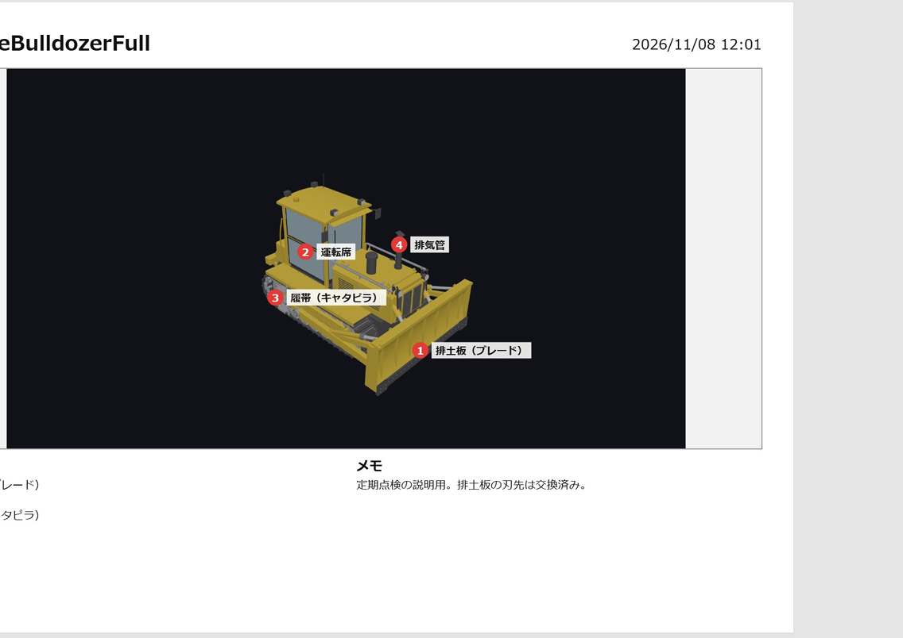
*保存された PDF。画面の絵に番号付きのラベルが入り、下に注釈の一覧とメモが付きます*

## 9. 表示設定

| ボタン・項目 | 内容 |
|---|---|
| ラベル表示 | ラベルを出す／隠す |
| エッジ表示 | 部品の輪郭線を出す／隠す |
| 展示モード | モデルがゆっくり回り続けます。触ると止まり、30 秒触らないとまた回り出します |
| ライトモード／ダークモード | 背景の明るさを切り替えます |
| 文字サイズ | 注釈・タイトル・スペックの文字の大きさを変えます |

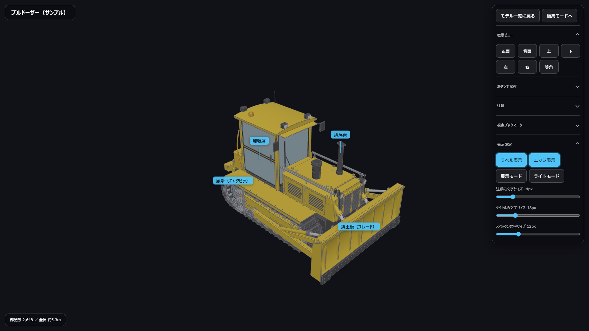
*エッジ表示をオンにしたところ。部品の境目がわかりやすくなります*

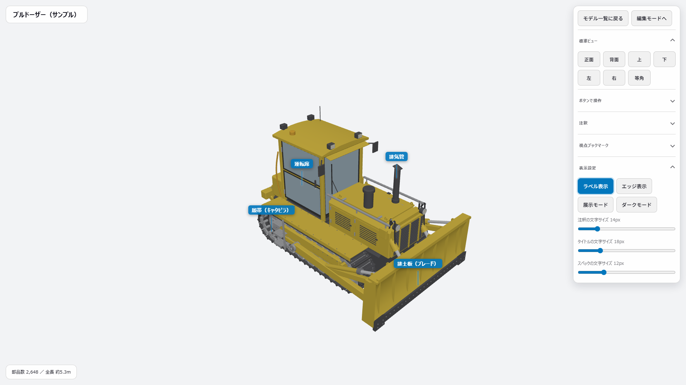
*ライトモード（明るい背景）*

編集モードでは「モデルの向き」の項目も出ます。モデルが横向き・逆さまに表示されるときは、実際の高さ方向に近い軸（X・Y・Z）を選んでください。

## 10. STEP ファイルを変換する（変換ツール）

CAD から出した STEP ファイル（.step / .stp）を、このビューアで見られる `.glb` に変換します。

1. **「変換ツール起動.bat」** をダブルクリックします
2. 「ファイルを選ぶ」で STEP ファイルを選びます
3. 品質を選びます（迷ったら「標準」）
4. 「変換する」を押します

元のファイルと同じフォルダに、次の3つのファイルができます。3つとも `viewer\models\` に置いてください。

| ファイル | 内容 |
|---|---|
| モデル名.glb | 本体 |
| モデル名_mid.glb | 操作中に使う中くらいの軽さの版 |
| モデル名_lod.glb | 操作中に使ういちばん軽い版 |

大きなモデルでは、回している間だけ軽い版に切り替えて、なめらかに動くようにしています。止めると元の細かい表示に戻ります。

| 品質 | 向いている使い方 | ファイルの大きさ |
|---|---|---|
| 粗い | 全体を見る・軽さ優先 | 小 |
| 標準 | ふだん使い | 中 |
| 細かい | 拡大して細部を見る | 大 |

> 部品名に日本語が入っている STEP ファイルでは、部品名が文字化けすることがあります（形の変換には影響しません）。

## 11. 困ったとき

| こんなとき | 確かめること |
|---|---|
| ブラウザが開かない | 「ビューア起動.bat」の黒い画面が開いたままか確かめ、ブラウザで `http://localhost:4000/` を開きます |
| モデル一覧に出ない | `.glb` が `viewer\models\` に入っているか確かめ、ブラウザを再読み込みします |
| モデルが横向き・逆さま | 編集モードの「モデルの向き」で高さ方向の軸を選びます |
| 動きが重い | 変換ツールでできた `_mid.glb`・`_lod.glb` も同じフォルダに置いてあるか確かめます。品質「粗い」で変換し直すと軽くなります |
| 「PDF保存先」が設定できない | フォルダの場所が正しいか、そのフォルダに書き込めるか（共有フォルダの権限）を確かめます |
| PDF保存で「サーバーに接続できませんでした」 | 「ビューア起動.bat」の黒い画面が閉じていないか確かめます |
| ラベルが次回に残っていない | 編集モードで「保存」を押したか確かめます |
